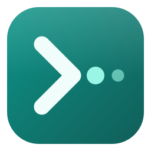

<div align="center">



# Continued

**A community-maintained fork of the Continue VS Code extension.**

</div>

> **Unofficial fork.** Continued is not affiliated with, endorsed by, or supported by Continue Dev, Inc. The upstream `continuedev/continue` repository is no longer maintained. This fork carries its own changes (AWS Bedrock and Bedrock Mantle support, live model lists, and more) and is released separately.

## Install

Continued is not published to the VS Code Marketplace. Install the `.vsix` build:

```bash
code --install-extension continued-win32-x64-<version>.vsix --force
```

The full instructions, including downloading builds from GitHub Actions, checking checksums and troubleshooting, are in [docs/continued-install.md](docs/continued-install.md).

## What's different from upstream

- **Amazon Bedrock**: one model list across the standard Bedrock endpoint and the Mantle endpoint. Mantle-only models are saved with the right provider automatically.
- **Live model lists**: after **Test connection** or the refresh button, the model picker shows the models your account can use, newest first.
- **Claude 4.6 and later**: uses adaptive thinking, which these models require.
- **Current models**: refreshed lists for Anthropic, OpenAI, Gemini and Bedrock.

## Documentation

The documentation site under `docs/` still describes upstream Continue in places and is being revised. Fork-specific install steps are in [docs/continued-install.md](docs/continued-install.md).

## Upstream

This fork starts from the final release of Continue (`continuedev/continue`, VS Code extension 2.0.0). Upstream is no longer maintained, and its CLI, JetBrains plugin and Marketplace listings are not part of this fork. Upstream's project history and contributors are at [continuedev/continue](https://github.com/continuedev/continue).

## License

Apache 2.0. The original work is © 2023–2026 Continue Dev, Inc. Changes in this fork are © 2026 b1tninja. See [LICENSE](LICENSE). This fork is not endorsed by or affiliated with Continue Dev, Inc.
