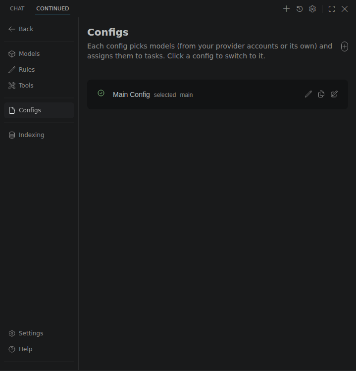

A config is a YAML file that picks models and assigns them to roles (chat, edit, autocomplete and so on), together with rules, tools and other settings. You can keep several, for example a `Local` config that only uses Ollama and a `Cloud` config that uses hosted models, and switch between them. Models in any config can use the [provider accounts](/customize/providers) in `providers.yaml`, so the configs themselves hold no API keys.

## Where configs live

| File | Shown as |
| :-- | :-- |
| `~/.continue/config.yaml` | The main config. It can be renamed but not deleted. |
| `~/.continue/configs/*.yaml` | Available in every workspace. |
| `<workspace>/.continue/configs/*.yaml` | Available in that workspace only. `.continue/agents` and `.continue/assistants` are read too. |

## Switch configs

- Click the config name in the chat toolbar and pick one.
- Press <kbd>Cmd/Ctrl</kbd>+<kbd>Shift</kbd>+<kbd>'</kbd> to move to the next config.
- Click a config in **Settings > Configs**.

The choice is remembered per workspace, along with the model picked for each role in each config.

GUI changes, such as picking models per mode, adding models, rule switches and tool rules, are saved to the selected config's file. If the selected config is not a local YAML file, they are refused rather than saved to a different config.

## Create, duplicate, rename and delete

In **Settings > Configs**:

<Frame>
   Configs, listing the main config with its rename, duplicate and edit buttons" />
</Frame>

- **+** creates a config. Choose a name, whether it goes in `~/.continue/configs` or the workspace, and whether to start empty or from a copy of another config. The new config is selected.
- The duplicate icon starts the same form with a copy of that config.
- The pencil renames a config. Its file is renamed to match, and its selection and per-role model picks move with it. The main config keeps its file name.
- The trash icon deletes the config's file after you confirm. Provider accounts and keys are kept.
- The edit icon opens the YAML in the editor. Edits made there are picked up when you save.

## Keys in plain text

When a config or `providers.yaml` contains an `apiKey` written out in full, **Settings > Configs** lists it and offers to move it. Each key is stored in the editor's secure storage (or in `~/.continue/.env` when there is none) and replaced in the file with a `${{ secrets.NAME }}` reference. Placeholders such as `YOUR_API_KEY_HERE` are ignored. After a config loads, the editor also offers this once per session; choose **Don't ask again** to stop the prompt.
