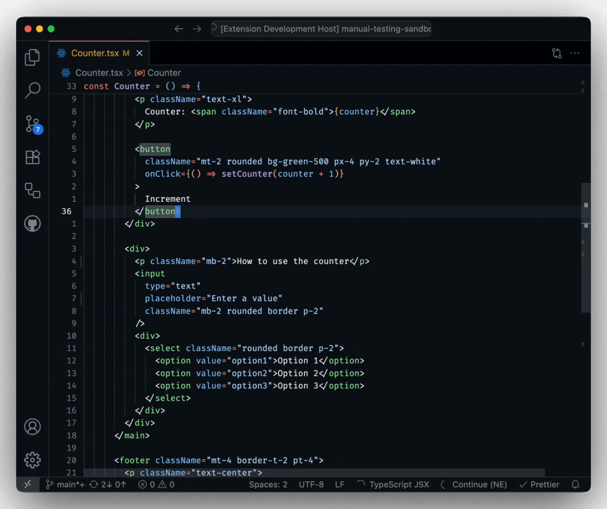

<Warning>
  Instinct is a 7 billion parameter model. You should expect slow responses if
  running on a laptop. To learn how to inference Instinct on a GPU, see the
  [Hugging Face model card](https://huggingface.co/continuedev/instinct).
</Warning>

Instinct is an open Next Edit model from Continue Dev, Inc., fine-tuned from Qwen2.5-Coder-7B. It predicts your next edit to keep you in flow.

<Frame>
  
</Frame>

### 1. Install Ollama

If you haven't already installed Ollama, see our guide [here](./ollama-guide.mdx).

### 2. Download Instinct

```bash
ollama run nate/instinct
```

### 3. Update your `config.yaml`

Open your `config.yaml` and add Instinct to the models section:

```yaml
# ... rest of config.yaml ...

models:
  - name: Instinct
    provider: ollama
    model: nate/instinct
    roles:
      - autocomplete
```
