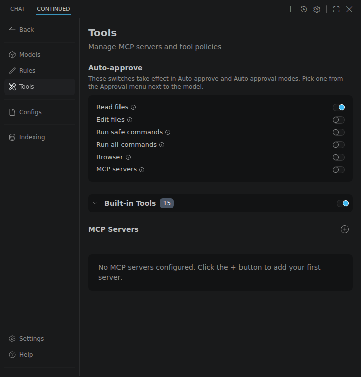

## How to Add Rules Blocks

Adding Rules can be done in your local configuration. Refer to the [Rules deep dive](../../customize/deep-dives/rules.mdx) for more details.

## How to Customize System Messages

You can customize the system messages for Chat, Agent, and Plan modes using model-level configuration:

```yaml
models:
  - name: GPT-4o
    provider: openai
    model: gpt-4o
    chatOptions:
      baseSystemMessage: "You are a helpful coding agent."
      baseAgentSystemMessage: "You are a systematic coding agent. Break down problems methodically."
      basePlanSystemMessage: "You are a planning agent. Create clear, actionable steps."
```

## How to Add MCP Tools

You can add MCP servers to your configuration to give Agent mode access to more tools. Consult the [MCP guide](../../customize/deep-dives/mcp.mdx) for more details.

## How to Configure Tool Policies

You can adjust the Agent mode's tool usage behavior to three options:

- **Ask First (default)**: Request user permission with "Cancel" and "Continued" buttons
- **Automatic**: Automatically call the tool without requesting permission
- **Excluded**: Do not send the tool to the model

:::warning
Be careful setting tools to "automatic" if their behavior is not read-only.
:::

To manage tool policies, open **Settings > Tools**:

1. Expand **Built-in Tools**, or an MCP server, to list its tools.
2. Click a tool's policy to change it.
3. Use the switch on a group to turn all of its tools on or off.

The **Auto-approve** switches at the top apply in the Auto-approve and Auto approval modes, chosen from the Approval menu next to the model.

<Frame>
   Tools, with the Auto-approve switches, Built-in Tools and MCP Servers" />
</Frame>

Tool policies are stored locally per user.
