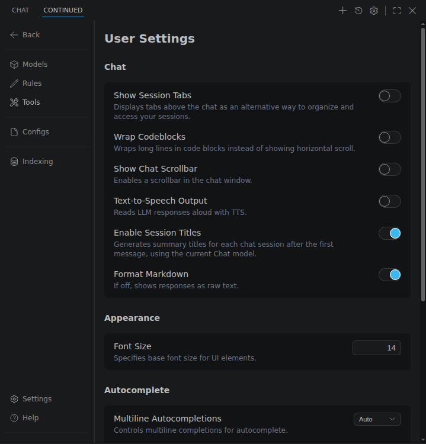

Continuous offers a handful of settings to customize autocomplete behavior. Open the User Settings page with the gear icon at the top of the Continuous panel; the Autocomplete settings are below Chat and Appearance.

<Frame>
  
</Frame>

For a comprehensive guide on all configuration options and their impacts, see the [Autocomplete deep dive](../../customize/deep-dives/autocomplete.mdx).
