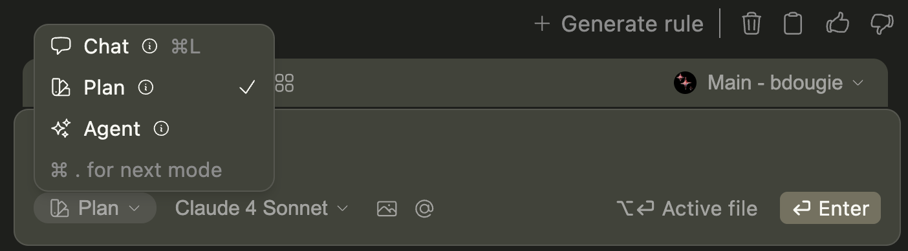

## How to Use It

Plan mode provides a safe environment for understanding and constructing plans without making changes. It equips the Chat model with read-only tools, allowing you to explore, analyze, and plan modifications before executing them.

### Use Plan

You can switch to `Plan` in the mode selector below the chat input box.

<Info>
  If Plan is disabled with a `Not Supported` message, the selected model or
  provider doesn't support tools. See [Model Setup](../agent/model-setup.mdx)
  for more information.
</Info>

### Chat with Plan

Plan mode lives within the same interface as [Chat mode](../chat/how-it-works.mdx) and [Agent mode](../agent/how-it-works.mdx), so the same [input](../chat/quick-start.mdx#how-to-start-a-conversation) is used to send messages and you can still use the same manual methods of providing context, such as [`@` context providers](../chat/context-selection.mdx) or adding [highlighted code from the editor](../chat/quick-start.mdx#how-to-include-code-context).

#### What Makes Plan Different

Unlike Agent mode, Plan mode:

- Only uses read-only tools (file reading, searching, analysis)
- Cannot modify, create, or delete files
- Focuses on understanding and planning rather than execution
- Provides a safe environment for exploration

### Common Use Cases

Plan mode is ideal for:

- **Code exploration**: Understanding how a codebase works
- **Planning refactors**: Analyzing impact before making changes
- **Debugging**: Investigating issues without modifying code
- **Architecture review**: Understanding system design and dependencies
- **Pre-implementation planning**: Thinking through changes before executing

### Example Workflow

1. **Start in Plan mode** to explore and understand the task
2. **Develop a plan** with the model's help
3. **Switch to Agent mode** when ready to implement changes

For example, you might say:

> Help me understand how the authentication system works and plan improvements to add OAuth support

Plan mode will analyze the existing code, understand the current implementation, and help you create a detailed plan—all without making any changes.

## Switching to Execution

When you're ready to implement your plan, simply switch to Agent mode using the mode selector or keyboard shortcut (`Cmd/Ctrl + .`). The conversation context carries over, so Agent mode can immediately start implementing the plan you developed.

<Tip>
  Use the keyboard shortcut `Cmd/Ctrl + .` to quickly cycle between Agent, Chat,
  and Plan modes.
</Tip>
